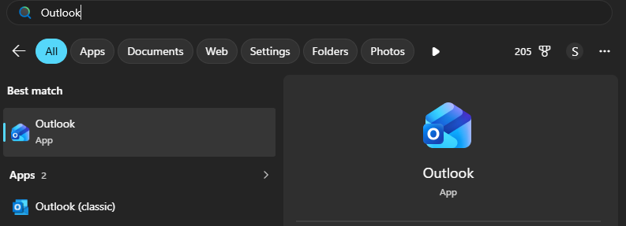
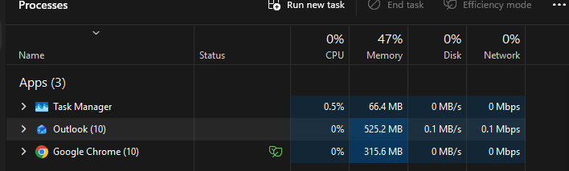
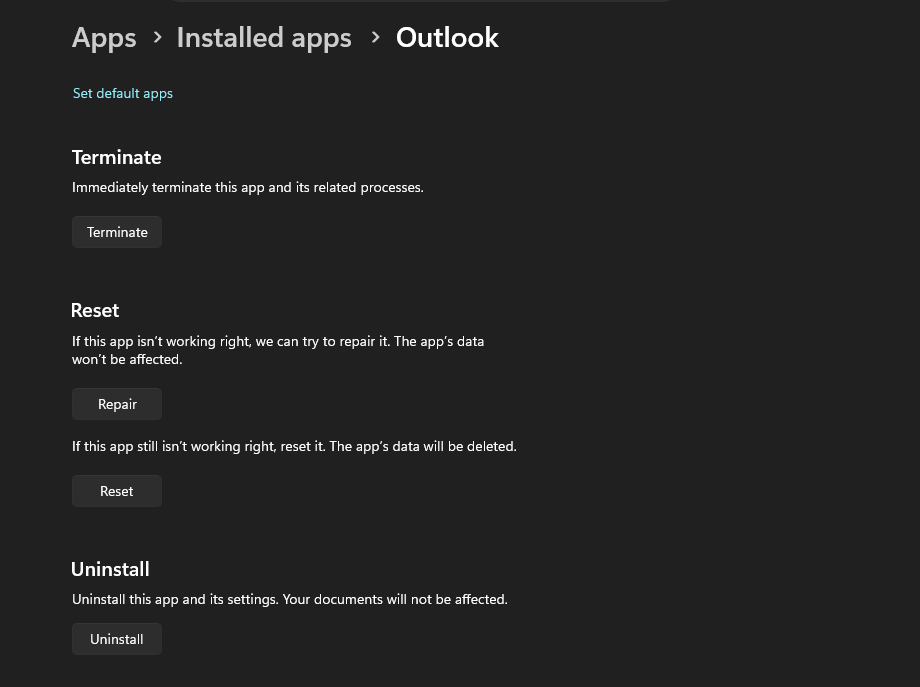
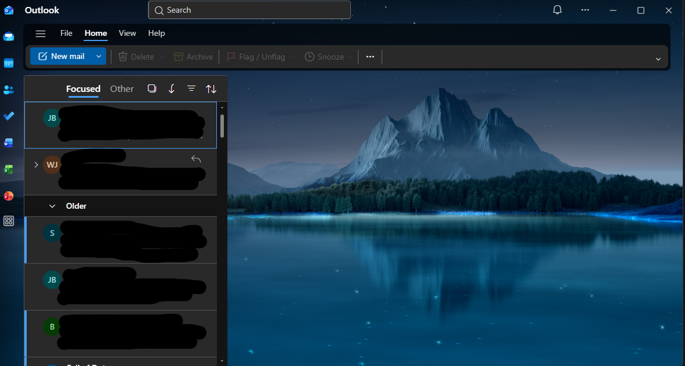

# Windows 11 Help Desk Troubleshooting Lab

## Project Overview
This project demonstrates basic Windows 11 help desk troubleshooting skills using Microsoft Outlook.

## Simulated Support Ticket

- **Ticket ID:** HD-001
- **Issue:** User reports that Microsoft Outlook will not open.
- **Device:** Windows 11 computer
- **Application:** Microsoft Outlook
- **Priority:** Medium, pending confirmation of business impact
- **Status:** Investigation completed; reported issue not reproduced

## Troubleshooting Steps

1. Searched for Outlook using Windows Search.
2. Launched Outlook and observed that it opened normally.
3. Opened Task Manager and confirmed that Outlook appeared in the Processes list.
4. Navigated to Outlook's Advanced options and confirmed that the Repair option was available.
5. Reopened Outlook and confirmed that the mail interface displayed normally.

## Results

Outlook launched successfully during testing. The reported issue could not be reproduced. No repair, reset, or reinstallation was performed.

## Skills Demonstrated

- Windows 11 application troubleshooting
- Task Manager navigation
- Windows app settings
- Evidence collection
- Incident documentation
- Verification and reporting

## Lessons Learned

A technician should gather evidence before changing application settings. A reported problem should not be marked as resolved until the result has been verified. When the issue cannot be reproduced, document the findings and request additional details if the problem returns.

## Screenshot Evidence

## Screenshot Evidence

### 1. Outlook Search

### 2. Task Manager

### 3. Outlook Advanced Options

### 4. Outlook Opens Successfully

